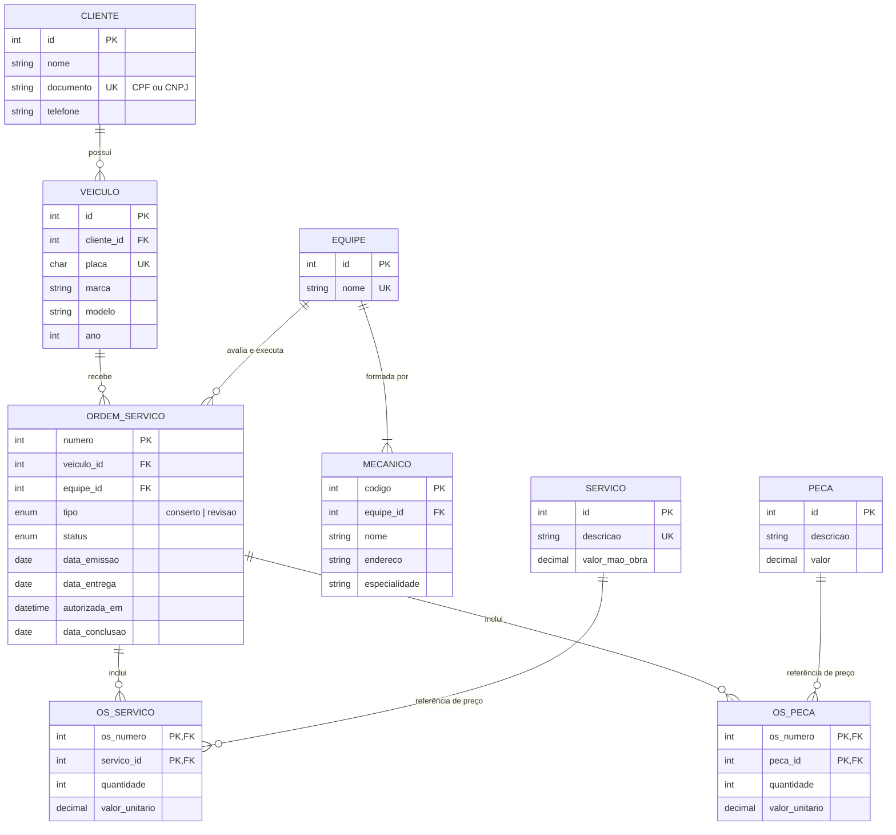

# Oficina mecânica: esquema conceitual

Desafio "Construindo um Esquema Conceitual para Banco de Dados", da formação SQL Database Specialist da DIO. A partir de uma narrativa curta sobre uma oficina mecânica, o desafio é identificar entidades, atributos e relacionamentos e explicar no README o que precisou ser interpretado.

## A narrativa

- Clientes levam veículos à oficina para conserto ou para revisões periódicas.
- Cada veículo é designado a uma equipe de mecânicos, que identifica os serviços e preenche uma OS com data de entrega.
- O valor de cada serviço vem de uma tabela de referência de mão de obra; o valor das peças também compõe a OS.
- O cliente autoriza a execução dos serviços, e a mesma equipe avalia e executa.
- Mecânicos têm código, nome, endereço e especialidade.
- Cada OS tem número, data de emissão, valor, status e data para conclusão dos trabalhos.

## Esquema

## Como interpretei o que a narrativa não diz

**Equipe por OS.** "Cada veículo é designado a uma equipe" poderia virar uma coluna em `veiculo`. Preferi registrar a equipe na OS: o mesmo carro pode voltar para outra revisão e ser atendido por outra equipe, e o histórico continua correto. A equipe da OS é quem avalia e quem executa, por isso existe um único relacionamento EQUIPE–OS.

**Mecânico pertence a uma equipe.** A narrativa fala em "equipe de mecânicos" sem dizer se um mecânico pode estar em várias. Considerei que cada mecânico está em uma equipe (1:N), o modelo mais comum numa oficina pequena.

**Conserto ou revisão.** Os dois motivos de visita viraram o atributo `tipo` da OS, em vez de entidades separadas, porque o fluxo (avaliar, orçar, autorizar, executar) é o mesmo.

**Valor da OS.** O valor não é digitado: é a soma dos serviços (preço da tabela de referência de mão de obra) e das peças. Serviços e peças entram na OS por relacionamentos N:M com quantidade e com o **preço do momento** em que foram orçados, para que um reajuste da tabela não mude orçamentos antigos.

**Autorização.** "O cliente autoriza a execução" virou o atributo `autorizada_em` e uma etapa do status: `em_avaliacao → aguardando_autorizacao → autorizada → em_execucao → concluida` (ou `cancelada`).

**Datas.** A OS tem a data de emissão, a data de entrega prometida ao cliente (a "data de entrega" preenchida pela equipe) e a data em que o trabalho foi de fato concluído. Assim dá para saber se houve atraso.

**Cliente.** A narrativa não detalha o cliente. Incluí nome, documento (CPF ou CNPJ, porque frotas de empresas também usam oficina) e contato.

## Do conceito ao banco

Para ter certeza de que o modelo se sustenta, escrevi também a versão em MySQL 8 (`sql/esquema.sql`), com as regras acima como restrições e triggers. O `testar.sh` cria o banco a partir dele, e o GitHub Actions faz isso a cada push. A implementação completa, com dados e consultas, ficou para o desafio seguinte da formação, o do projeto lógico.
